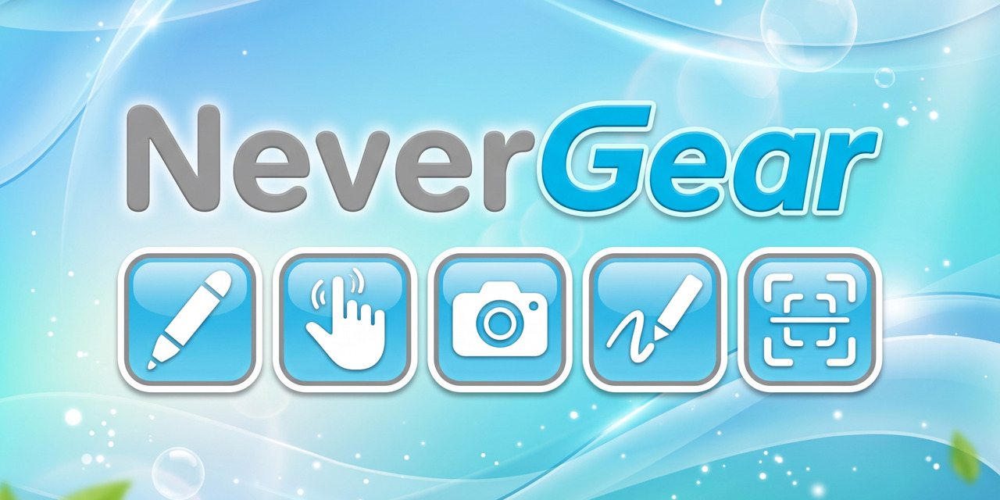
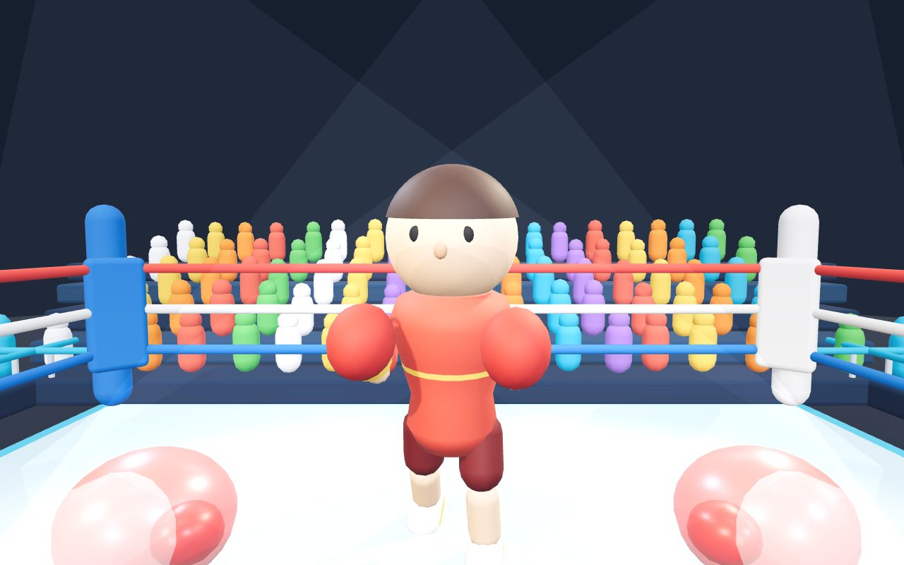

<div align="center">



# Wii Web Sports Arena

**A NeverGear experiment: your body is the controller.**

Run, swing, punch, dodge, and play directly in the browser with nothing but a webcam. Wii Web Sports Arena turns real-time pose and hand tracking into arcade sports — no dedicated motion controller, no wearable, no backend, and no installation.


**Actively being built. Ambitious in scope, honest about what is measured.**

</div>

## What it is

Wii Web Sports Arena is a body-controlled web arcade that explores a simple question: how close can a normal browser camera get to the immediacy of motion-controlled console sports? The current build includes stadium athletics over 100, 200, and 400 meters, timing-based tennis, camera-driven boxing, a three-sport Iron Man challenge, and a Mii creator whose avatar is stored locally in the browser.

The project is part game, part computer-vision research platform, and part love letter to playful interaction. It is designed around a disciplined pipeline: camera frames stay on the device, inference runs in warm Web Workers, noisy landmarks are filtered and calibrated online, kinematic detectors turn movement into intent, and a fixed-step Three.js loop renders responsive sport scenes.

## The arena

<table>
  <tr>
    <td align="center" width="33%">
      <br />
      <strong>Athletics</strong><br />
      100, 200, and 400 m races
    </td>
    <td align="center" width="33%">
      <br />
      <strong>Tennis</strong><br />
      Timing controls placement
    </td>
    <td align="center" width="33%">
      <br />
      <strong>Boxing</strong><br />
      Punch, guard, dodge, duck, and move
    </td>
  </tr>
</table>

## The experience

| Mode | How you play | What makes it feel fair |
| --- | --- | --- |
| Athletics | Run in place and pump your arms. The harder you move, the faster your runner goes. | A short warm-up learns the range of the person and camera instead of expecting one universal body. |
| Tennis | Swing across your body. Early contact sends the ball cross-court; late contact sends it straight. | Contact is judged from the swing timeline, so direction emerges from timing rather than button presses. |
| Boxing | Punch toward the screen, hold both fists up to guard, lean left or right, duck, and use footwork to control range. | The tutorial measures the player's neutral pose, punch reach, and personal dodge shapes before the real fight. |
| Iron Man | Finish athletics, tennis, and boxing in sequence without returning to the menu. | Each stage keeps its own result, then the final summary presents the full run. |
| Menu and Mii creator | Point with your hand, pinch to select, rotate your hand to spin the channel ring, and hold a fist to go back. | The interface treats the hand as a first-class cursor instead of hiding camera control behind mouse emulation. |

Athletics and tennis are body-only. Boxing is camera-driven and also exposes keyboard equivalents for movement, punching, guard, and dodges.

## Why it is different

- **Zero extra hardware:** a desktop webcam is the only sensor required.
- **Local-first perception:** video is processed on the player's device and is not uploaded to the game server.
- **Invisible calibration:** the system adapts continuously to camera framing, body proportions, movement range, punch reach, and dodge style.
- **A menu built for hands:** pinch clicking, fist-based back navigation, and rotational flicks turn the channel menu itself into part of the game.
- **Engineering with receipts:** detectors are pure and testable, real pose recordings can be replayed, and performance work is measured rather than assumed.
- **A complete product shell:** the playable arena lives inside a broader site with home, product, vision, research, and papers pages.

## The perception pipeline

```text
webcam frame
  → MediaPipe Pose/Hand Landmarker in module Web Workers
  → one-frame-in-flight capture clients
  → 1-Euro filtering and online calibration
  → pure kinematic and gesture detectors
  → fixed-timestep sport simulation
  → Three.js renderer
```

The default runtime uses CPU inference with the Lite pose model for broad compatibility; `?delegate=gpu` switches to GPU inference with the Full model. MediaPipe WASM and model files are versioned, copied during the build, and verified by SHA-256 before release assets are produced.

## Quick start

### Requirements

- Node.js 24 LTS and npm 11 or compatible.
- A modern desktop browser with a camera and WebGL 2. Chrome, Edge, or Firefox are recommended.
- HTTPS in production for camera access; `localhost` works in development.
- Framing that shows the head and torso down to the hips. Legs and feet are optional; boxing footwork benefits from visible hips, and tennis and boxing benefit from visible hands and arms.

### Run locally

```bash
npm ci
npm run dev
```

Open the printed local URL and allow camera access when prompted. The website opens at `/`; the playable arena is mounted at `/app`, with additional pages at `/vision`, `/papers`, and `/product`.

### Verify

```bash
npm test
npm run lint
npm run build
npm run check:articles
npm run preview
```

## Controls

### Camera and hand controls

| Action | Input |
| --- | --- |
| Move the menu cursor | Move one visible hand |
| Select in a menu | Pinch thumb and index finger |
| Spin the channel ring | Rotate or flick the hand sideways |
| Go back in a menu | Hold a closed fist until the ring completes |
| Run in athletics | Run in place while pumping your arms |
| Hit in tennis | Swing sideways; timing controls direction |
| Punch in boxing | Extend either arm quickly toward the screen |
| Guard in boxing | Hold both fists up near the face |
| Dodge in boxing | Lean left or right, or duck down |
| Move in boxing | Shift the torso forward/backward or use the keyboard fallback |
| Play again | Raise both hands for 1.5 seconds |
| Return to the menu from results | Cross your forearms in an X for 1.5 seconds |

### Boxing keyboard fallback

| Action | Keys |
| --- | --- |
| Move around the ring | `W` `A` `S` `D` |
| Punch | `E` |
| Guard | Hold `Q` or `ArrowDown` |
| Dodge | `ArrowLeft` / `ArrowRight` |

## Architecture map

- `packages/core/` (`@wii/spatial-core`): the headless perception package — pose and hand workers, worker protocols, capture clients, filtering, replay, rotational gestures, and spatial-runtime primitives.
- `src/cv/`: thin application wiring over the core package, including local model assets, CPU/GPU delegate selection, warm-up, diagnostics, and adaptive calibration.
- `src/kinematics/`: pure detectors over pose snapshots for intensity, swings, punches, framing, guard, ducks, dodges, footwork, gestures, and legacy obstacle-course movement.
- `src/games/`: the fixed-step game loop, disposal helpers, Three.js scenes, athletics, tennis, boxing, and the legacy obstacle course.
- `src/mii/`: procedural Mii face specifications, rendering, persistence, and generated opponent identities.
- `src/ui/`: the game canvas, camera picture-in-picture, pose overlay, hand cursor, channel menu, lobbies, and Mii creator.
- `src/app/`, `src/pages/`, `src/components/`: the website shell and routes that present the arena as a complete product.
- `tests/`: deterministic detector and gameplay tests with synthetic pose fixtures; real recordings stay outside git because they are personal data.
- `docs/`: the technical knowledge base. Start with [docs/README.md](docs/README.md) and [docs/jogos-pelo-corpo.md](docs/jogos-pelo-corpo.md); most deep-dive material is currently written in Portuguese.

## Privacy and runtime boundaries

Camera video is processed locally in the browser. The game does not upload frames or recordings. MediaPipe states that it may send performance and API-usage metrics to Google; this disclosure is shown in the camera picture-in-picture and documented in [THIRD_PARTY_NOTICES.md](THIRD_PARTY_NOTICES.md). All pose models are hosted with the application, versioned by content hash, and verified during the build. Mii customization is stored in browser storage, not in an account system.

## Deployment

The project deploys as a static Vite build on Vercel. Use the repository root as the Root Directory, `npm run build` as the build command, and `dist` as the output directory. With an authenticated Vercel CLI, run:

```bash
npx vercel --prod
```

The resulting HTTPS URL enables browser camera access without a native install. `vercel.json` preserves direct links to the site's routes and marks versioned MediaPipe and asset files as immutable cache content.

## The human side of the machine

<table>
  <tr>
    <td align="center" width="33%">
      <br />
      <strong>Gustavo Moreira</strong><br />
      Design, motion, and play feel
    </td>
    <td align="center" width="33%">
      <br />
      <strong>Lucas Coimbra</strong><br />
      Design, engineering, and systems
    </td>
    <td align="center" width="33%">
      <br />
      <strong>The little controller</strong><br />
      Kept as a reminder of the magic we are trying to remove
    </td>
  </tr>
</table>

<div align="center">
<picture>
  <source media="(prefers-color-scheme: dark)" srcset="assets/credits-dark.png?v=2" />
  
</picture>
</div>
