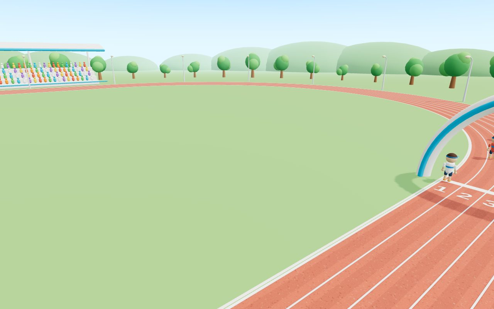

<div align="center">


# Nevergear Web Sports Arena

**A Nevergear experiment: your body is the controller.**

Run, swing, punch, and dodge directly in the browser with a webcam; Boxing also offers keyboard controls. Nevergear Web Sports Arena turns real-time pose and hand tracking into arcade sports — no dedicated motion controller, no wearable, no backend, and no installation.


**Actively being built. Ambitious in scope, honest about what is measured.**

</div>

## What it is

Nevergear Web Sports Arena is a body-controlled web arcade that explores how close a normal browser camera can get to the immediacy of motion-controlled console sports. The current build includes stadium athletics over 100, 200, and 400 meters, timing-based tennis, camera-driven boxing, a three-sport Iron Man challenge, and a Mii creator whose avatar is stored locally in the browser.

The project is part game, part computer-vision research platform, and part love letter to playful interaction. Video is processed locally in the browser, movement becomes game intent through calibrated pose and hand tracking, and the sports scenes are rendered in Three.js.

## Language

The website and game interface support Portuguese and English. On first launch, the app follows the browser's first supported language preference and falls back to English; a manual choice is saved in the browser. It uses browser language preferences, not a direct operating-system lookup. See [docs/language-support.md](docs/language-support.md) for the selection rules and implementation details. The documentation is written in English, while the website's research articles remain available in Portuguese and English.

Start with the [documentation index](docs/README.md) for gameplay, research, architecture, and historical reviews.

## The arena

<table>
  <tr>
    <td align="center" width="33%">
      <br />
      <strong>Athletics</strong><br />
      100, 200, and 400 m races
    </td>
    <td align="center" width="33%">
      <br />
      <strong>Tennis</strong><br />
      Timing controls placement
    </td>
    <td align="center" width="33%">
      <br />
      <strong>Boxing</strong><br />
      Punch, guard, dodge, duck, and move
    </td>
  </tr>
</table>

## Deployment

The project deploys as a static Vite build on Vercel. Use the repository root as the Root Directory, `npm run build` as the build command, and `dist` as the output directory. With an authenticated Vercel CLI, run:

```bash
npx vercel --prod
```

The resulting HTTPS URL enables browser camera access without a native install. `vercel.json` preserves direct links to the site's routes and marks versioned MediaPipe and asset files as immutable cache content.

<div align="center">
<picture>
  <source media="(prefers-color-scheme: dark)" srcset="assets/credits-dark.png?v=2" />
  
</picture>
</div>
