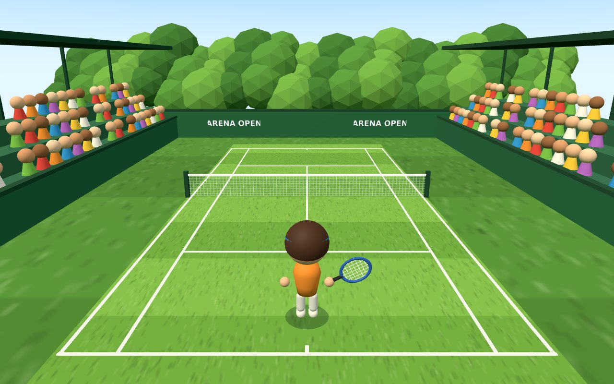
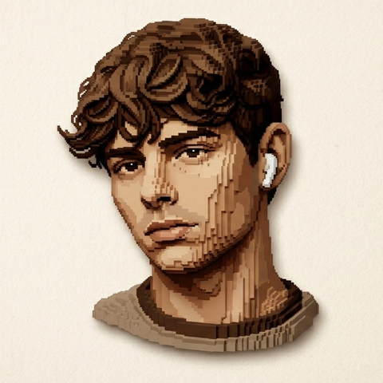
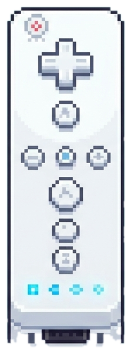

<div align="center">


# Wii Web Sports Arena

**A NeverGear experiment: your body is the controller.**

Run, swing, punch, dodge, and play directly in the browser with nothing but a webcam. Wii Web Sports Arena turns real-time pose and hand tracking into arcade sports — no dedicated motion controller, no wearable, no backend, and no installation.


**Actively being built. Ambitious in scope, honest about what is measured.**

</div>

## What it is

Wii Web Sports Arena is a body-controlled web arcade that explores how close a normal browser camera can get to the immediacy of motion-controlled console sports. The current build includes stadium athletics over 100, 200, and 400 meters, timing-based tennis, camera-driven boxing, a three-sport Iron Man challenge, and a Mii creator whose avatar is stored locally in the browser.

The project is part game, part computer-vision research platform, and part love letter to playful interaction. Video is processed locally in the browser, movement becomes game intent through calibrated pose and hand tracking, and the sports scenes are rendered in Three.js.

## The arena

<table>
  <tr>
    <td align="center" width="33%">
      <br />
      <strong>Athletics</strong><br />
      100, 200, and 400 m races
    </td>
    <td align="center" width="33%">
      <br />
      <strong>Tennis</strong><br />
      Timing controls placement
    </td>
    <td align="center" width="33%">
      <br />
      <strong>Boxing</strong><br />
      Punch, guard, dodge, duck, and move
    </td>
  </tr>
</table>

## Deployment

The project deploys as a static Vite build on Vercel. Use the repository root as the Root Directory, `npm run build` as the build command, and `dist` as the output directory. With an authenticated Vercel CLI, run:

```bash
npx vercel --prod
```

The resulting HTTPS URL enables browser camera access without a native install. `vercel.json` preserves direct links to the site's routes and marks versioned MediaPipe and asset files as immutable cache content.

## The human side of the machine

<table>
  <tr>
    <td align="center" width="33%">
      <br />
      <strong>Gustavo Moreira</strong><br />
      Design, motion, and play feel
    </td>
    <td align="center" width="33%">
      <br />
      <strong>Lucas Coimbra</strong><br />
      Design, engineering, and systems
    </td>
    <td align="center" width="33%">
      <br />
      <strong>The little controller</strong><br />
      Kept as a reminder of the magic we are trying to remove
    </td>
  </tr>
</table>

<div align="center">
<picture>
  <source media="(prefers-color-scheme: dark)" srcset="assets/credits-dark.png?v=2" />
  
</picture>
</div>
